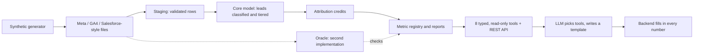

# MarketingIQ

An internal, read-only assistant that answers marketing questions from computed numbers. You ask "which campaigns brought in the most qualified leads last month?". It chooses the right analytics tools, reads their results, and answers. Every number in the answer is filled in by the backend from a tool result and can be traced to the call that produced it. The language model never writes a number itself.

> **Status:** a personal side project modelled on a home-services business in Ontario (LG Home Comfort). It is not commissioned or endorsed by the company. **All data is synthetic:** a generated, fictional business. It will be demoed to the performance marketing manager; any use of real data waits for the approvals listed under [Real data](#real-data). Keep the repository private (U-23). It has no connection to The RO brand or website.

## What it does

- **Answers questions** on spend, leads, qualification, consultations and sales. It covers funnels, attribution under three models, Meta vs GA4 vs CRM reconciliation, "what changed and why", and data quality.
- **Refuses or abstains when it should.** It refuses contact details, transcripts, changes to campaigns, and questions about the real business. It abstains when the data can't give a number, for example a cost with no spend feed. When a name is ambiguous, it asks which one you mean, and you can reply in the same conversation.
- **States its caveats:** low attribution coverage, recent cohorts that are still filling, seasonality, mapping rules that are unverified, small counts that are hidden, and changes that are within noise.
- **Shows its work.** The demo page highlights every number, lists the tool call and path it came from, shows the full tool trace and where the time went, and can reopen any earlier answer from the run log.

## How well it works

Measured with Google's free Gemini 3.5 Flash-Lite model, on 32 benchmark questions plus 12 held-out questions written after tuning and committed before any model saw them:

| Measure | Result |
|---|---|
| Benchmark, main set (used for tuning) | 22 of 32 |
| Held-out set (never used for tuning) | 8 of 12 |
| Numbers in answers not traceable to a tool | 0, by construction |
| Numbers in tool results recomputed by an independent implementation | 663, all match |

The failures are mostly a small model's: answers that leave out a needed fact, or mix up two sources. One answer read real numbers backwards. Numbers by reference guarantees the numbers are real, not that they're read correctly. Details, and why the scores are probably still a little optimistic: [`docs/benchmark.md`](docs/benchmark.md).

## How it's built



Python 3.14, FastAPI, PostgreSQL 18, SQLAlchemy, Pydantic. The language model is any OpenAI-compatible endpoint; the default is Gemini's free tier.

Design decisions that matter:

- **Numbers by reference** ([ADR-006](docs/decisions/ADR-006-numbers-by-reference.md)): the model writes `{{c2:rows[key=…].values.cost_per_lead}}` and the backend writes "$31.20". A typed number is rejected.
- **Definitions before code:** one metric registry ([`docs/metrics.md`](docs/metrics.md)), evidence-tiered attribution ([`docs/attribution.md`](docs/attribution.md)), versioned rules with `verified=false` until checked against the real systems.
- **An independent oracle** ([`docs/oracle.md`](docs/oracle.md)) recomputes the numbers from the raw files, written from the docs and not from the code. It found a real attribution bug.
- **Deterministic selections:** ranks, flags, direction labels and significance are computed by the tools, so the model never compares numbers itself.

## Run it

Requirements: [uv](https://docs.astral.sh/uv/), PostgreSQL 18, and a free [Gemini API key](https://aistudio.google.com/apikey) for the assistant.

```bash
uv sync
cp .env.example .env                 # database URLs, LLM_API_KEY
uv run alembic upgrade head
uv run python -m synthetic generate  # the fictional dataset, in data/synthetic/
uv run python -m marketingiq.ingest load data/synthetic/default-seed-20261014
uv run python -m marketingiq.core build --org synthetic-home-services
uv run uvicorn marketingiq.api.app:app
```

Then open `http://127.0.0.1:8000/` for the demo page, or `/docs` for the API. From the terminal: `uv run python -m marketingiq.assistant "your question" --trace`.

Database roles: `miq_owner` (owns the databases, runs migrations and loads) and `miq_app` (read-only for analytics; it may only insert into the run log). Both use `timezone = 'UTC'`.

Checks: `uv run pytest` (integration tests need `TEST_DATABASE_URL`), `uv run ruff check .`, `uv run python -m benchmark check`, and `uv run python -m benchmark run [--set heldout]` to score the configured model.

## Documentation

Start with the [build journal](docs/build-journal.md): every step, what was built and why, concepts, and how to explain it.

| Topic | Document |
|---|---|
| Scope, users, the canonical questions | [`scope.md`](docs/scope.md), [`question-tool-map.md`](docs/question-tool-map.md) |
| Metric definitions, caveats, suppression | [`metrics.md`](docs/metrics.md) |
| Lead classification and attribution | [`lifecycle_and_classification.md`](docs/lifecycle_and_classification.md), [`attribution.md`](docs/attribution.md) |
| Synthetic data and planted scenarios | [`synthetic-data.md`](docs/synthetic-data.md) |
| Loading and the core model | [`loading.md`](docs/loading.md), [`core-model.md`](docs/core-model.md) |
| Analytics services and REST API | [`analytics-api.md`](docs/analytics-api.md) |
| The assistant | [`assistant.md`](docs/assistant.md) |
| Oracle and benchmark | [`oracle.md`](docs/oracle.md), [`benchmark.md`](docs/benchmark.md) |
| Decisions | [`docs/decisions/`](docs/decisions/) (ADR-001 to ADR-007) |
| Unknowns and how to verify them | [`unverified-register.md`](docs/unverified-register.md) |
| Presenting it | [`demo-guide.md`](docs/demo-guide.md) |

## Data and security principles

- Synthetic data only. No real customer records, contact details, chat or call transcripts, or session recordings, anywhere.
- The model sees aggregates only, through typed tools; there is no free-text SQL. Text from the data is screened for instructions aimed at the assistant before the model reads it.
- Platform-reported conversions and CRM leads are separate measures and are never added together.
- Attribution is assigned credit, not proof of cause.
- Small counts are hidden (k = 5), but hiding alone can be defeated by subtraction across queries ([ADR-007](docs/decisions/ADR-007-disclosure-control.md)). Real data needs consistent noise first.
- The free model tier may use prompts for training. That is acceptable only because the data is fictional.

## Real data

Nothing real is loaded until these gates pass, in order ([`unverified-register.md`](docs/unverified-register.md)):

- **R0, governance:** written approval of purpose, fields, de-identification, model provider, retention and disclosure control.
- **R1, readiness:** a local audit of approved, de-identified exports, with no model involved.
- **R2, controlled integration:** read-only credentials; imported totals compared with the source systems.
- **R3, operational approval:** hosting, sign-in and roles, logging and a security review.
