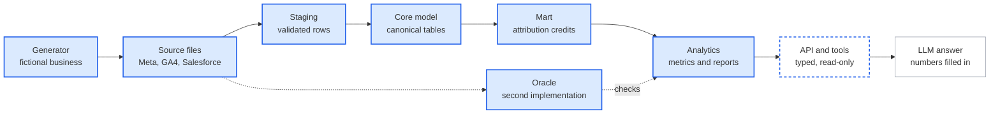

# MarketingIQ — Build Journal

Last updated 2026-10-15. Kept in the repo (`docs/build-journal.md`) and updated after every step.

## How to use this journal

This journal records every step of MarketingIQ: what we built, why we built it that way, and what you can learn from it. I update it after each commit, so it always matches the repo at `C:\Users\Dp\MarketingIQ`.

Each step has four parts:

- **What we built**: the change and its commit id.
- **Why**: the decision, and the alternative we rejected.
- **Concepts**: the ideas worth learning; the terms are in the glossary near the end.
- **Interview angle**: how to explain it in one or two sentences.

To study the code, open a terminal in the repo and run `git log --oneline`, then `git show <commit id>` next to the matching step. Reading the tests first is often the fastest way in: they say what the code promises.

## The project on one page

MarketingIQ is an internal, read-only assistant that answers marketing questions for LG Home Comfort with numbers the backend computes, never the LLM. It's a personal side project on synthetic data, to be demoed to the performance marketing manager.

**What it is:** a Python backend (FastAPI + PostgreSQL) that loads marketing data, computes metrics and attribution deterministically, and lets an LLM pick typed, read-only tools and explain their results.

**What it isn't:** a customer-facing chatbot (Sarah and Claire already do that), a tool that changes budgets or writes to Salesforce, or proof of real business performance.

**Why it's a good GenAI project:** the hard parts are the ones employers care about. Answers must never invent numbers, must state their assumptions, must refuse when the data can't answer, and every one of those behaviours is measured by tests.

### How data flows, and what exists today

Numbers flow from files to answers; the LLM never computes them. Filled boxes exist today, the dashed box is in progress (the REST API is built; the assistant's tools come in Phase 4), and the grey box is planned. Ground truth never enters the database: it goes straight to the tests. The oracle reads the same files independently and checks the analytics' numbers.

### Progress log

Newest first; generated from `git log`.

| Date | Commit | Step |
| --- | --- | --- |
| 2026-10-15 | `cc0fa69` | Oracle: an independent second implementation, checked cell by cell |
| 2026-10-15 | `995b15c` | Click-ID-only credit goes to (unmapped), as attribution.md says |
| 2026-10-15 | `7ce92ab` | Build journal moves into the repo |
| 2026-10-15 | `5e8aa57` | REST API for the analytics services |
| 2026-10-15 | `2bc1a56` | Change explanation: segment contributions to a metric's change |
| 2026-10-15 | `c20396f` | Data-quality report |
| 2026-10-15 | `4282289` | Lead funnel and source reconciliation reports |
| 2026-10-15 | `1ece22a` | Metric registry and performance service |
| 2026-10-15 | `db0e8af` | Attribution credits in the mart, and indexes on every foreign key |
| 2026-10-15 | `9e36c38` | Analytics periods: presets, comparisons and period caveats |
| 2026-10-15 | `c863b90` | Core model: tables, transactional build and ground-truth tests |
| 2026-10-15 | `ac3257e` | Core rules: versioned rule book and pure functions that apply it |
| 2026-10-15 | `17f19a9` | Loader: idempotent, transactional loads into staging, with a CLI |
| 2026-10-15 | `99e4a02` | Staging schema and row validation with named error codes |
| 2026-10-15 | `bc87f26` | Synthetic generator: recording layer, export, manifest and CLI |
| 2026-10-14 | `8aa9456` | Synthetic generator: CRM leads, lifecycle and Meta-reported leads |
| 2026-10-14 | `46e2e92` | Synthetic generator: households, website journeys, Meta delivery |
| 2026-10-14 | `95f0695` | Synthetic generator: validated config, named random streams, calendar |
| 2026-10-14 | `d68ac41` | Synthetic data specification (draft for review) |
| 2026-10-14 | `c68f07f` | CI: lint, tests and a fresh migration against Postgres 18 |
| 2026-10-14 | `400dfb6` | Database foundation: schemas, role grants, load-batch audit tables |
| 2026-10-14 | `e1d50b8` | Project skeleton: settings, database engines, /health, tests |
| 2026-10-14 | `695a0aa` | Phase 0: scope, metric, lifecycle and attribution definitions |

## Phase 0: defining before building

We wrote down what every metric, lead class and attribution rule means before writing any code (commit `695a0aa`, the `docs/` folder). A query can be technically correct and still answer the wrong question, if "leads" or "last month" means something different to the code than to the reader.

### The decisions that shape everything

| Decision | Why | Alternative we rejected |
| --- | --- | --- |
| Synthetic data first | Needs no approval, is reproducible, and has known right answers to test against | Real exports: need approval and come with no answer key |
| Evidence-tiered attribution | Phone, Meta lead-form and Messenger leads have no website journey, so every result shows how much of it is backed by evidence | One attribution model over all leads, which overstates certainty |
| Default population is new-customer acquisition | Repairs, billing calls and existing customers would otherwise inflate "leads" | Counting every form submission as a lead |
| The LLM sees aggregates only | No personal data ever reaches the model, which makes approval easier later | Giving the model row-level access or free SQL |
| Numbers by reference | The LLM writes `{{c1:totals/cpl}}` and the backend fills in the value, so it can't invent numbers | Checking numbers after the fact, which is fuzzy |
| Unverified register | Every guess about Salesforce fields, tracking or sales cycles is labelled and turns into a caveat | Quietly assuming how the company's systems work |

### What the review caught

Mapping all 25 business questions to tools exposed gaps the prose had hidden: five missing metrics, missing dimensions such as campaign tactic, and no way to know when a cold snap or page change happened (hence the annotations table). Two contradictions would have become bugs:

- Attribution credit was only given through *verified* mappings, but every synthetic mapping starts unverified, so nothing would ever have been credited. The fix: a mapping decides where credit goes; its verification only decides the caveat.
- The public quote form has no request-type field, so most quote-form leads would have been classed `unknown` and dropped from acquisition. The fix: a documented default (`install_replace`), flagged in every result that uses it.

**Concepts:** metric definitions, date basis (cohort vs event), population, attribution vs causation, verified vs unverified assumptions.

**Interview angle:** "Before coding, I mapped every business question to a tool and a metric definition. That found contradictions that would have silently zeroed out attribution."

## Step 1: project skeleton

**What we built** (`e1d50b8`): a Python 3.14 project managed by `uv`, settings read from `.env`, two database connections, a `/health` endpoint and the first tests.

**Why each choice:**

- **`uv` and `uv.lock`**: one command installs exactly the same package versions on every machine and in CI. The old `requirements.txt` was a dump of your whole Anaconda install, which nobody else could reproduce.
- **Settings from the environment (`pydantic-settings`)**: passwords live in `.env`, which git ignores; `.env.example` shows the shape without secrets. Pydantic fails at startup if a required setting is missing, instead of failing later at random.
- **Two database roles**: `miq_owner` creates tables and loads data; `miq_app` can only read. Every read path, and later the LLM's tools, uses `miq_app`, so a bug or a prompt injection can't change data. This is called least privilege.
- **`/health` returns 503 when the database is down**, and never puts connection details in the response. Load balancers and monitors read the status code.
- **Integration tests skip when the test database isn't there**, so unit tests still run on any laptop.

**Concepts:** dependency locking, configuration through environment variables, least privilege, health checks, dependency injection (FastAPI's `Depends`, swapped for a test engine in tests).

**Interview angle:** "Analytics and the assistant run under a read-only database role, so even a successful prompt injection can't modify data."

## Step 2: database foundation

**What we built** (`400dfb6`): migration `0001`, which creates four schemas, gives each role its permissions, and adds the audit tables every load will use.

**Why:**

- **Four schemas, one job each** (ADR-005). `staging` holds rows exactly as the source exported them; `core` holds the cleaned, canonical model; `mart` holds derived results such as attribution credit; `app` holds the assistant's run log. When real Salesforce exports arrive later, only the step into `core` changes; analytics code doesn't.
- **The read-only role can't see `staging`**, so analytics can never accidentally read unvalidated rows.
- **`ALTER DEFAULT PRIVILEGES`** grants read access to tables that don't exist yet. Without it, every future migration would need to remember its own `GRANT`.
- **Hand-written migrations, checked by a test.** Alembic can generate migrations, but generated ones are easy to accept without reading. A test migrates an empty database and fails if the result differs from the Python table definitions ("drift").
- **A partial unique index on `load_batches`**: a file that loaded successfully can't load twice, but a failed attempt can be retried. That's what makes a load idempotent: running it again does no harm.
- **Check constraints instead of Postgres `ENUM` types**, because adding a value to a Postgres enum later is awkward inside a migration.

**Concepts:** migrations, schema separation, default privileges, partial indexes, idempotency, drift.

**Interview angle:** "Loads are idempotent: a unique index on the file's hash, scoped to successful loads, makes a rerun a no-op while still allowing retries."

## Step 3: continuous integration

**What we built** (`c68f07f`): a GitHub Actions workflow (`.github/workflows/ci.yml`) that starts a throwaway PostgreSQL 18, creates the same two roles, then runs the linter, the formatter check, every test and a migration of an empty database. It runs once the repo is pushed to GitHub; nothing is pushed yet.

**Why:**

- **The same checks on every change**, on a clean machine, so "works on my laptop" can't hide a missing dependency.
- **Real Postgres, not SQLite**: dates, time zones and permissions behave differently in SQLite, and those are exactly the things this project depends on.
- **CI fails instead of skipping** when the test database is missing (`MIQ_REQUIRE_TEST_DB=1`). Locally a skip is convenient; in CI a skipped test is a silent hole.

**Concepts:** CI, service containers, test environments, why a skipped test is dangerous.

**Interview angle:** "Integration tests skip locally when there's no database, but CI sets a flag that turns a skip into a failure, so they can never silently stop running."

## Step 4: synthetic data generator

**What we built** (`d68ac41` spec, then `95f0695`, `46e2e92`, `8aa9456`, `bc87f26`): `uv run python -m synthetic generate` simulates a fictional Ontario home-services business for 24 months and writes files shaped like Meta, GA4 and Salesforce exports, plus a separate answer key. It takes about 45 seconds.

**Why it's built this way:**

- **Spec before code.** Every invented number was written in `docs/synthetic-data.md` first, so you could challenge the assumptions without reading code.
- **Validated config.** All assumptions live in `src/synthetic/config/default.toml`. Pydantic rejects typos and any mix whose shares don't add up to 100%, so a bad edit fails loudly instead of quietly skewing the data.
- **Simulate what happened, then what was recorded.** First the generator decides the truth: who needed what, which ads they clicked, whether they bought. Only then does it apply tracking gaps such as rejected cookies, missing UTMs and typos. The application only ever sees the recorded version, just as with real data.
- **Named random streams.** Every random draw comes from a stream keyed by the seed plus names such as the day and the household. The same seed always produces byte-identical files, and a change in one place doesn't reshuffle everything else.
- **Retargeting is added after outcomes are decided**, so it can't change anyone's decision. It still collects attribution credit because it reaches people who were already likely to buy. That's a built-in demonstration that attribution credit isn't causation.
- **A manifest with file hashes and realized rates**, so anyone can check that the files weren't altered and how close the output came to the config.

### Calibration: does the output match the spec?

| Measure | Spec | Generated |
| --- | --- | --- |
| GA4 sessions | ~150,000 | 139,000 |
| New-customer leads | ~4,500 | 4,461 |
| Sales won from them | ~500 | 500 |
| Meta spend per month (CAD) | ~4,500 | 4,755 |
| Qualification: Meta lead form vs quote form | lower | 25% vs 67% |

### Mistakes caught along the way

- **My spec contradicted itself:** CAD 45,000 a month of Meta spend would have produced over a million sessions, not 150,000. Running the simulation exposed it, and the world was scaled down consistently.
- **A config-merge bug:** the small test config overrides only two numbers in `[traffic]`, and my merge rule replaced the whole section. A failing test caught it; the rule now merges top-level sections key by key.
- **Meta's reported leads came out at 1.04× the CRM,** below the intended gap. The reason was realistic: Meta can't see phone leads or visitors who reject cookies. I raised the view-through rate a little and corrected the doc to the realized 1.2×.

**Concepts:** simulation, ground truth, reproducibility, seeds, selection bias, calibration.

**Interview angle:** "The test data has known answers. The generator writes ground truth separately from what tracking recorded, so I can measure whether the system recovers the truth, and where tracking gaps make that impossible."

## Step 5: staging loaders

**What we built** (`99e4a02`, `17f19a9`): `uv run python -m marketingiq.ingest load <dataset folder>` reads seven source files into the `staging` schema. The full 24-month dataset, about 165,000 rows, loads in about 14 seconds.

**How one file loads:**

1. Hash the file. If this exact file already loaded, skip it.
2. Check the header. A missing required column fails the whole file, and the reason is recorded.
3. Validate every row with its Pydantic model. A bad row gets a named error code (`invalid_date`, `clicks_exceed_impressions`, ...) and is kept in `rejected_rows`.
4. Count identical rows as duplicates; reject rows that share a key but disagree.
5. Write everything in one transaction, bulk-inserting the good rows with PostgreSQL `COPY`.

**Why:**

- **Reject the row, not the file.** One bad date shouldn't throw away 13,000 good leads. Every rejected row is kept with its raw values and its reason, so nothing disappears silently.
- **Error codes are a contract** (`docs/loading.md`). Later, the data-quality report and the assistant can say *why* data is missing. Hand-written fixtures in `tests/fixtures/dirty/` hold one problem per row, and a test checks each gets exactly its code.
- **Staging tables are built from the row models**, so each column list lives in one place. The migration stays hand-written for review, and the drift test proves the two match.
- **One transaction per file**: a crash leaves nothing half-loaded, and the hash check makes a rerun harmless.
- **`COPY` instead of row-by-row inserts**: it streams all rows to Postgres in one command, which keeps 139,000 GA4 rows fast.
- **Staging keeps values exactly as typed** ("Mississauga ON", " Kenora "). Cleaning is the core step's job; keeping the raw value means you can always see what the source really sent.

**Result on the default dataset:** no rejected rows, 679 duplicate GA4 rows dropped, and 138,528 sessions kept, exactly the generator's recorded count. Running the load again skips all seven files, and the read-only app role gets "permission denied" on staging.

**Concepts:** validation at the boundary, quarantining bad rows, natural keys, transactions, bulk loading, snapshot semantics (each file is a full export; the newest successful batch wins).

**Interview angle:** "Loads are idempotent and transactional: each file is hashed, validated row by row and committed in one transaction, so reruns are harmless and bad rows are quarantined with a reason instead of silently dropped."

## Step 6: core model

**What we built** (`ac3257e` rules, `c863b90` tables and build): `uv run python -m marketingiq.core build --org synthetic-home-services` rebuilds the canonical model in about 18 seconds. Campaigns are linked across Meta and GA4, every session gets a channel, and every lead is classified, deduplicated, given a clean city and an evidence tier.

**How it's organized:**

1. `rules.toml`: every cleaning rule, versioned, all `verified = false`.
2. `rules.py`: pure functions that apply them, with 49 unit tests.
3. `records.py`: staging rows to core records, in memory, no database.
4. `build.py`: one transaction that deletes the organization's core rows, writes the new ones and records the build.

**Why:**

- **Rules as data, not code.** When you learn the real Salesforce picklist values at work, you edit `rules.toml` and set `verified = true`; no code changes. Every build records which rule versions it used.
- **Pure functions first, database last.** The whole build can run in memory, which is how the problem below was diagnosed in seconds.
- **A full rebuild instead of incremental updates.** 13,000 leads rebuild in seconds, and a full rebuild can't drift: running it twice gives the same answer.
- **Unknown stays unknown.** A lead with no recorded request type is `unknown`, not guessed into acquisition, and an unrecognized city keeps its raw text.

**What the ground truth showed:** duplicates (676), spam (324) and test leads (77) match the answer key exactly, and no billing or repair lead is ever counted as acquisition. One real limitation surfaced: the quote form has no request-type field, so nominations sent through it are classed as acquisition, 66 of 4,300 leads (1.5%). It's now documented, pinned down by a test, and on your list of questions for work.

**Concepts:** canonical model, versioned rules, full refresh vs incremental loads, precision and recall, the side effects of a default.

**Interview angle:** "Tests against synthetic ground truth found that a classification default we'd agreed on silently counts nominations as sales leads. Because the rules are versioned data, fixing it is a config change once the business decides."

## Step 7: periods and attribution credits

**What we built** (`9e36c38` periods, `db0e8af` credits):

- **Periods.** "Last month" resolves against the dataset's `data_as_of` date, never the computer's clock. With data up to 2026-09-30, last month is September: the most recent *complete* month. Comparisons can be the previous period, the same period last year, or custom dates.
- **Attribution credits.** For every first lead, under three models (first touch, last non-direct, linear) and three lookback windows (7, 30, 90 days), the credit each campaign or channel receives, stored in `mart.lead_attribution_credits`. Every model and window adds up to exactly 12,587, the number of first leads.

**Why:**

- **The backend resolves dates and echoes them.** The LLM will never work out what "last month" means; every answer will show the exact dates, so an ambiguity is visible instead of silent.
- **Month-over-month carries a seasonal warning.** In heating and cooling, comparing October with September mostly measures the weather; the warning suggests year over year.
- **Credits are precomputed.** Reports become simple sums, and every number traces back to a lead and, for web journeys, the exact visit that earned the credit.
- **Exact decimals.** Three thirds stored as 0.33333333 each would add up to 0.99999999. The last share absorbs the rounding, so credited totals always equal lead counts.

**What went wrong:** the second rebuild stalled for over five minutes. Deleting 138,000 sessions made Postgres check each one against the credits table, which had no index on `session_id`: one full scan per deleted row. The fix was an index on every foreign key a rebuild deletes through, plus a test that fails if any foreign key lacks one. Profiling the build afterwards showed that most of its 40 seconds is the database enforcing integrity, which is acceptable for now.

**First result worth noticing:** under last non-direct attribution, retargeting is among the top-credited campaigns, even though in this world it causes nothing (scenario S08). Credit is not cause.

**Concepts:** attribution models, lookback windows, conservation (totals that must reconcile), foreign-key indexes, profiling before optimizing.

**Interview angle:** "A rebuild stalled; profiling traced it to an unindexed foreign key checked once per deleted row. I fixed it and added a test that fails if any foreign key lacks an index, so that whole class of bug can't come back."

## Step 8: metrics and the performance service

**What we built** (`1ece22a`): a registry of 27 metrics, each defined once with its unit, formula and a plain-language definition, and `get_performance`, the function the assistant's main tool will call. It takes a period, an optional comparison, up to two groupings (campaign, channel, service line, region, entry point, evidence tier...), a population and an attribution model. It answers in 0.02 to 0.2 seconds, under the read-only database role.

**Why it's built this way:**

- **Definitions live in one place.** The REST API, the assistant and the tests all read the same registry, so "cost per qualified lead" can't mean two different things in two places.
- **Lead counts are credit-weighted.** Every lead's credits add up to exactly 1, so the rows always add up to the total, whether you group by campaign or by service line.
- **Cost divides spend by leads from campaigns that have spend data.** Organic and email leads don't make Meta look cheaper, and a group without spend data says "no spend source" instead of showing a cost of zero.
- **A missing number is null with a reason, never 0.** "Spend can't be split by service line" and "no leads this month" are different facts, and both differ from "cost was zero".
- **Every result echoes its exact dates, population and model, plus warning codes.** The assistant will repeat these, so a reader always knows what the number covers.
- **Small counts are hidden.** Under 5 is suppressed, plus one more cell when a single hidden value could be worked out from the total.

**What the first results show:**

| Finding | Scenario |
| --- | --- |
| The summer test campaign spent CAD 673 in September with 0 leads credited, because its visits can't be linked to it | S09 |
| Heat pump prospecting in March vs February: spend up 37%, click-through rate down 33%, with a seasonal warning | S04 |
| Only 56% of September's new-customer leads have campaign-level evidence, so campaign figures carry a low-coverage warning | coverage |
| Half of the new-customer leads have no known service line: the quote form doesn't ask | data quality |

**A bug the tests caught:** a cell that was empty for a stated reason got relabelled "hidden for privacy" when one of its inputs was small. The stated reason now always wins.

**Concepts:** metric registries (a "semantic layer"), weighted counts, null versus zero, small-cell suppression, caveats travelling with numbers.

**Interview angle:** "Every number carries what it means: the resolved dates, the population, the attribution model and machine-readable caveats. A missing value is null with a reason, so the assistant can say *why* it can't answer instead of inventing a zero."

## Step 9: reports and the REST API

**What we built** (`4282289` funnel and reconciliation, `c20396f` data quality, `2bc1a56` change explanation, `5e8aa57` REST API): four reports on top of the metric registry, plus a web API that serves all of them. Start it with `uv run uvicorn marketingiq.api.app:app --reload` and open `http://127.0.0.1:8000/docs` to try every endpoint in the browser. The reference is `docs/analytics-api.md`.

**The four reports, and the question each answers:**

- **Funnel:** "Where do leads drop off?" Leads, then qualified, booked, completed consultation, opportunity, won, with the rate between each pair of stages.
- **Source reconciliation:** "Why does Meta say 16 leads when Salesforce says 8?" It puts Meta's own count, GA4 form sessions and CRM leads side by side, per campaign. It never adds them together.
- **Change explanation:** "Why did leads go up?" It splits a change between two periods into each segment's share.
- **Data quality:** "What can't we trust about this period?" It reports evidence coverage, classification defaults, unmapped campaigns, tracking capture by week, missing days, rejected rows, cohort maturity and time zones.

**Why:**

- **Reports reuse the registry instead of writing their own SQL.** The funnel is a performance query with fixed metrics, so "qualified" means the same thing in the funnel as in a cost-per-qualified-lead figure.
- **Reconciliation shows sources next to each other, never summed.** Each source counts something different: Meta counts view-throughs and can't see phone calls, while GA4 loses visitors who reject cookies. Adding them would count the same customer two or three times.
- **Change explanation uses arithmetic that adds up.** For counts, each segment's effect is its own change, so the effects sum exactly to the total. For ratios (cost per lead), a segment's effect is the actual total minus the total there would have been if only that segment had stayed the same. That is a *counterfactual*, and the result says these effects don't sum exactly.
- **Directions are labelled for the reader.** `spend_up_paid_leads_down` means the LLM never has to compare two signs itself, which is a classic place for a language model to slip.
- **A capture drop is reported as a tracking problem.** If the share of web leads with a campaign falls to a fraction of its usual level, the hidden form fields broke; customers didn't disappear.
- **The API is thin on purpose.** Each endpoint takes the service's own Pydantic query model and calls the service. Phase 4's assistant tools will call the same functions, so the API, the tools and the tests can't drift apart.
- **Bad queries are refused before any SQL runs.** An unknown metric, an extra field (so there is nowhere to slip in raw SQL) or spend split by service line gets a 422. An unknown organization gets a 404. Every route uses the read-only `miq_app` role, and the tests run them that way.

**What the reports found on the default synthetic data:**

| Finding | Scenario |
|---|---|
| September funnel: 176 new-customer leads → 101 qualified → 57 booked → 40 consultations → 37 opportunities → 9 won, with a warning that recent leads haven't had time to close | maturity |
| Furnace prospecting: Meta reports 16 leads, the CRM links 8 (2.0×); heat pump: Meta 6, CRM 9, because Meta can't see phone leads | S07 |
| The summer test campaign: Meta reports 7 leads, the CRM links 0; 2,124 sessions and CAD 2,697 of spend aren't in the mapping sheet | S09 |
| Leads rose from 161 in August to 176 in September; paid search accounts for 11 of the 15 (73%) | change |
| Web leads with a captured campaign fell to 13% and 31% in the weeks of 6 and 13 July, against about 92% normally; flagged as `capture_drop` | S06 |

**A trade-off to decide:** with small-cell suppression at 5, half the channels in the September change explanation (5 of 10) show as hidden. That protects privacy, but a manager will see blanks. The options are listed in `docs/analytics-api.md`: explain at channel level rather than campaign level, relax the threshold for spend (which isn't about people), or default to longer periods. It is best decided once real volumes are known.

**What's deliberately not here yet:** an independent cross-check (an *oracle*) that recomputes key numbers a second, simpler way. It moves to Phase 3, together with the evaluation questions, so both are in place before any LLM work starts.

**Concepts:** reconciliation, counterfactual, contribution to change, HTTP status codes 422/404, thin API layer, dependency override in tests.

**Interview line:** "The API, the assistant's tools and the tests all call the same service functions with the same typed query models. Invalid questions are rejected by validation before any SQL runs, and every answer echoes the exact dates and caveats it covers."

## Step 10: the oracle (Phase 3 begins)

**What we built** (`cc0fa69` oracle, `995b15c` the bug it found): `src/oracle/`, a second implementation of MarketingIQ's numbers. It reads the dataset's CSV files directly, with no database and no imports from the app, and it was written from the documents, not from the app's code. A test compares the two cell by cell. Reference: `docs/oracle.md`.

**Why:**

- **A system can't check itself.** Tests written by the same person who wrote the code share that person's assumptions. A second implementation built from the *spec* fails exactly where the code and the spec disagree. This is called *N-version* checking, or a *test oracle*.
- **It's written in a deliberately different style.** The app uses SQL over tables and stores decimals; the oracle uses one plain loop per lead and exact fractions. Shared bugs are less likely when the code shares nothing.
- **Only the rule book is shared.** It is configuration (which page means which service line), and two copies would only drift apart. A wrong rule would be wrong in both, which is why the rules are still marked unverified.
- **It compares raw numbers, before rounding and privacy suppression.** That way even a tiny test world can be checked cell by cell. Rounding and suppression have their own tests.
- **It comes before the LLM.** Phase 4's benchmark will ask "did the assistant get the right number?", and "right" needs a source that isn't the system under test.

**What it found:**

| Finding | Who was wrong |
|---|---|
| 272 leads with only a Google click ID were credited to "(no campaign)"; `attribution.md` says "(unmapped)", because the click points at a campaign nobody can name | The app: fixed in `995b15c`, with a unit test |
| Offer pages (`/offers/heat-pump/`) give a service line | The docs didn't say so: `core-model.md` now does |
| "Vaughan ON" and "Toronto, Ontario" lose the province before matching | The docs only said "cleaned spelling": now spelled out |
| Exact duplicate GA4 rows | The oracle's first draft: the loader drops them, as documented |

After the fixes, the two implementations agree everywhere: 26 tests on the tiny world, and 640 comparisons over one year of the full dataset (every lead measure by every dimension, model and lookback, plus sessions and ad spend).

**What's next in Phase 3:** close the three tool gaps the question map exposes (`compare_attribution_models`, per-row ranks for the "cheap leads, expensive qualified leads" question, and `list_dimension_values`). Then write the benchmark: every canonical question plus the refusal and safety cases, each with expected tool calls, caveats and oracle values.

**Concepts:** test oracle, N-version checking, specification vs implementation, exact arithmetic with fractions, comparing before presentation layers (rounding, suppression).

**Interview line:** "I wrote a second, independent implementation from the spec, not the code, and compared it with the app cell by cell. It found a real attribution bug and two rules the spec had never written down. Now both agree on every number, so my evaluation benchmark has a trustworthy answer key."

## Concepts glossary

The terms that come up most, grouped by field. I'll add to this as new ones appear.

| Term | Meaning | Where it shows up |
| --- | --- | --- |
| UTM parameters | Tags added to a link (`utm_source`, `utm_campaign`, ...) so analytics knows which campaign a visit came from | GA4 sessions, hidden form fields |
| gclid / fbclid | Click IDs that Google Ads and Meta add to a link automatically | GA4 sessions, `Click_Id_Type__c` |
| Attribution | A convention for giving a conversion's credit to the touches before it: first-touch, last-touch or split evenly (linear) | `docs/attribution.md` |
| Attribution vs causation | Credit shows who was present before a sale, not who caused it | Retargeting scenario S08 |
| Evidence tier | How much proof links a lead to a campaign, from a full web journey (T1) to nothing (T5) | `docs/attribution.md` |
| Acquisition lead | A new customer asking about an installation or replacement; the default population for metrics | `docs/lifecycle_and_classification.md` |
| CPL / CPQL | Cost per lead / cost per qualified lead: spend divided by (qualified) leads | `docs/metrics.md` |
| ROAS | Return on ad spend: revenue divided by spend. Unreliable here until we know what "Amount" means | `docs/metrics.md` |
| View-through | A conversion an ad platform claims because the person saw an ad, without clicking | Meta-reported leads |
| Cohort | A group defined by when it started, such as leads created in March, followed over time | Funnel metrics |
| Immature cohort | A recent cohort whose sales haven't had time to close, so it looks worse than it is | Scenario S12 |
| Least privilege | Give each component only the permissions it needs | `miq_app` role |
| Migration | A versioned script that changes the database schema | `migrations/versions/` |
| Drift | The database and the code's table definitions disagreeing | `test_models_match_migrations` |
| Idempotent | Safe to run again: a second run changes nothing | `load_batches` unique index |
| Staging / core / mart | Raw source rows / cleaned canonical model / derived results | ADR-005 |
| Ground truth | What really happened in the simulation, kept apart from what was recorded | `truth/` folder |
| Seed | The number that makes random data reproducible | `--seed` |
| Small-cell suppression | Hiding counts under 5 so individuals can't be singled out | `docs/metrics.md` |
| PII | Personally identifiable information: names, emails, phones, addresses | Never in any file or prompt |
| Natural key | The columns that identify a row in its source, such as a Salesforce Id | Staging unique constraints |
| Transaction | A group of database writes that commit together or not at all | One per loaded file |
| COPY | PostgreSQL's bulk-load command: one stream instead of one insert per row | The loader's good rows |
| Quarantine | Keeping invalid rows aside with a reason instead of dropping them | core.rejected_rows |
| Snapshot load | Each file is a full export; the newest successful load is the current version | docs/loading.md |
| Canonical model | One agreed, cleaned version of each thing (campaign, lead, session), whatever source it came from | The core schema |
| Rule book | Cleaning rules kept as versioned data, each section marked verified or not | src/marketingiq/core/rules.toml |
| Full refresh | Rebuilding everything from source each time, instead of patching changes in | The core build |
| Precision / recall | Of the leads we called acquisition, how many really were / of the real acquisition leads, how many we found | Ground-truth tests |
| Lookback window | How far before a lead a visit can be and still earn credit (7, 30 or 90 days) | Attribution credits |
| Last non-direct | All credit to the latest visit that wasn't someone typing the address directly | The default attribution model |
| Foreign-key index | An index on a column that points at another table, so deletes and joins don't scan everything | test_every_foreign_key_has_a_supporting_index |
| Profiling | Measuring where time is spent before deciding what to optimize | The core build |
| Semantic layer | One shared definition of each metric that every report and tool uses | src/marketingiq/analytics/metrics.py |
| Weighted count | Counting each lead by its attribution credit (e.g. 0.5), so splits add up to whole leads | Lead metrics by campaign |
| Null reason | Why a value is missing (no spend source, zero denominator...), shown instead of a fake 0 | Performance results |
| Reconciliation | Showing how different systems count the same thing, side by side, and explaining the gaps instead of adding them up | /analytics/reconciliation |
| Counterfactual | What a number would have been if one thing had stayed the same | Ratio change explanations |
| Contribution to change | How much of a total's change one segment accounts for; arithmetic, not a cause | share_of_change |
| Capture rate | The share of web form leads whose hidden fields recorded a campaign; a sudden drop means broken tracking | Data-quality report, scenario S06 |
| 422 / 404 | HTTP status codes: the request is invalid / the thing asked about doesn't exist | The REST API |
| Test oracle | An independent way to know the right answer, used to judge the system under test | src/oracle/, docs/oracle.md |
| N-version checking | Building the same thing twice from the spec, so the copies' disagreements reveal bugs | The oracle vs the app |
| Exact fractions | Numbers like 1/3 kept exactly instead of rounded, so totals add up with no error | The oracle's credits |

## Interview talking points

If you can explain these five points in your own words, you can defend the project in an interview. Each gets stronger as later steps land.

1. **The LLM never computes numbers.** It chooses typed tools and writes the answer with placeholders; the backend fills in every number from the tool results. (Lands in the assistant phase.)
2. **Every answer states how much evidence supports it.** Attribution comes with coverage: how many leads have a traceable journey, and how many are phone calls or Meta forms nobody can trace.
3. **The test data has known answers.** The generator keeps ground truth apart from what tracking recorded, so tests can measure whether the system recovers the truth.
4. **Least privilege everywhere.** Analytics and the assistant use a read-only database role; the LLM only ever sees aggregates, never personal data.
5. **Definitions before code.** Mapping 25 business questions to tools exposed contradictions that would otherwise have shipped as silent bugs.

Claims to avoid until they're true: that the company uses it, that it improved any marketing result, or that it's accurate on real data. Everything so far is measured on synthetic data.

## Things to verify at work

These questions involve no company data, only how the systems are set up. Each answer replaces a guess in `docs/unverified-register.md`; tick them off as you learn them.

- [ ] Is Google Ads used, and can its spend be exported? (U-10)
- [ ] Do the quote and callback forms pass UTMs and the GA client ID into Salesforce as hidden fields? (U-06)
- [ ] Is there call tracking? The site shows two different 1-866 numbers. (U-08)
- [ ] Is the GA4 export to BigQuery switched on? Its history can't be recovered later. (U-09)
- [ ] Do Calendly bookings sync into Salesforce? (U-04)
- [ ] What does a Salesforce opportunity's Amount mean: purchase price, financed total, lease value or monthly? (U-05)
- [ ] What are the real Lead Status values, and is field history tracked? (U-02, U-03)
- [ ] Can the project use the company's name, or be shown publicly? Check your employment agreement and ask your manager. (U-23)
- [ ] Is there a separate form for nominations, or do they come through the quote form? (U-20; they currently count as acquisition leads)
- [ ] How many leads a month does each campaign really get? That decides whether hiding counts under 5 leaves useful campaign-level answers (U-15)
